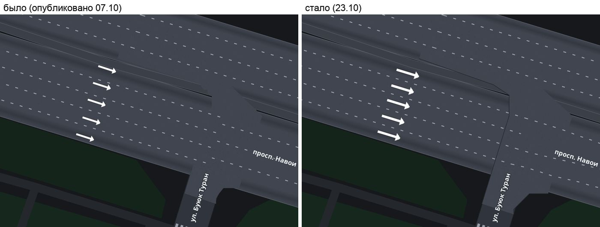
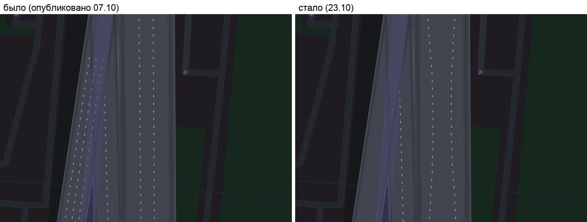
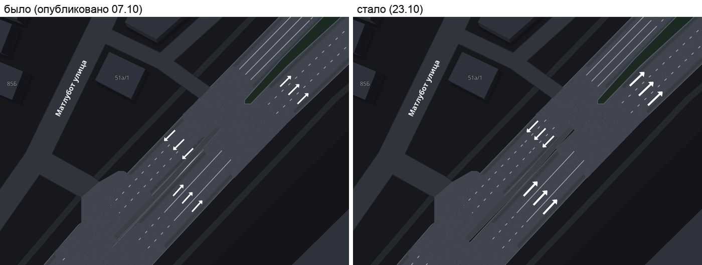

# Аудит отрисовки дорог (28.G), 23.10.2026

Просьба владельца: «хочу, чтобы дороги были профессиональными». Эталон —
Яндекс Карты/Навигатор и Apple Maps. Здесь — геометрия и иерархия дорог:
ширины, стыки, развязки, мосты, разметка, кромки, подписи, обзорные зумы.
Цвета разбираются, только если дефект в контрасте или иерархии и одной палитрой
он не закрывается.

По ходу аудита владелец прислал снимок с телефона: стрелки полос лежат на
линиях разметки. Это было исправлено первым, в генераторе (коммиты 0b79620 и
8ff1873 на этой ветке), — см. §1. Остальное — разведка и план, генераторы по
ним не правились.

## 0. Как снималось

- Рендер — `server/omt/render_native.js`: тот же нативный MapLibre, что на
  телефоне (Node 22 + @maplibre/maplibre-gl-native; обвязка в scratchpad,
  кадр 700×500 pt @2x, наклон до 55°). Headless Chrome не использовался.
- Основа — распакованные тайлы OMT (`~/RadarMapBuild/omt/publish/omt`).
- Наш MVT:
  - «опубликовано» — 698 тайлов z15 по рамке Ташкента, скачанные с
    `soulmed.uz/radarmap/mvt/` (выпуск 2610071018, сборка 07.10);
  - «сейчас» — вырезка Ташкента, собранная генератором этой ветки
    (`~/RadarMapBuild/tash/out_28g_fix`).
- Стиль — `make_style.py` из main (палитра «Чистый» 28.A уже влита), пути
  подменены на локальные. Слои DrivingDeclutter для кадров «в поездке»
  выключены так же, как в `EngineMapView.drivingHiddenLayers`.
- Отличие от телефона: светофор в превью — значок спрайта, а приложение
  ставит свой графитовый (`EngineModernStyle.ownTrafficLight`). Слоёв
  приложения (маршрут, камеры, «я») в кадрах нет.
- Все кадры (88 шт., в том числе со старой палитрой и пары было/стало) лежат
  в `../shots_28g/`. В отчёте — 18 отобранных, в
  [`roads_audit_2026-10-23/`](roads_audit_2026-10-23/).

## 1. Сделано: стрелки полос и линии разметки

Опубликованные тайлы — от 07.10. Правки «стрелки в ширину ленты» (13.10) и
«углы перекрёстков» (18.10) на телефон так и не вышли. Но и генератор main
стрелки на линии ставил, хотя реже. Новые проверки в
`server/road_metrics.py` — в воротах публикации:

| Мера, Ташкент | опубликовано 07.10 | main до правки | эта ветка |
|---|---|---|---|
| стрелок не посередине своей полосы, на 1000 | 414 | 115 | 13 |
| значок не по ширине полосы, на 1000 | 0 | 52 | 11 |
| наибольший поворот стрелки к оси ленты | 64,4° | 66,9° | 0,7° (потолок 2°) |
| стрелок повёрнуто больше 2°, на 1000 | 180 | 188 | 0 |
| ступенек пунктира на 100 км | 38 | 42 | 3 |
| разметки за кромкой, м/км | 0 | 0 | 0 |
| стрелок всего | 752 | 844 | 633 |

Причины, по которым стрелки ложились на линии, и что исправлено:

1. **Полосы без стрелки терялись.** В turn:lanes вида «through|none|none»
   полосы «без стрелки» при упаковке пропадали. Ряд делил ленту на одну
   полосу, и стрелка вставала посередине ленты — на линию, а значок
   растягивался на 2–3 полосы. Похоже, это и есть снимок владельца. Теперь
   число полос ряда хранится в битах 48–51 точки (`turn_count`).
2. **Разная ширина.** Линии делили min(ширина по тегу, нарисованная), а
   стрелки — нарисованную. Теперь обе делят нарисованную.
3. **Разное число полос.** Линии считались по lanes, стрелки — по turn:lanes.
   Ввёл одно правило `marked_lanes()`. У односторонней ленты без тега lanes
   полосы берутся из turn:lanes. Если число не совпадает, ряд ищет место
   дальше по подходу, а не найдя — не рисуется.
4. **Ряд не на своей ленте.** Ряд не ставится без своей ленты по ходу и на
   чужую ленту: встречную, сошедшуюся у узла, или поперечную. Полосы уже
   2,2 м не размечаются и стрелок не получают.
5. **Поворот.** Ряд поворачивался по азимуту точки с шагом 3°. Теперь — по
   оси ленты, хордой ±8 м. Два ряда в одной точке сводятся в один.
6. **Ступенька пунктира.** На стыке кусков с разным lanes пунктир прыгал
   вбок. Теперь линии длинного куска плавно сходятся на 30 м; короткий
   кусок держит своё деление, чтобы стрелки остались посередине полос.

| | |
|---|---|
|  |  |
| Навои у Буюк Турон, ночь z19.3: стрелки были повёрнуты к пунктиру, стали вдоль ленты и посередине полос. | Стык 4 → 5 полос: линии рвались вбок, стали сходиться плавно. Левая лента сжата до полос уже 2,2 м — линий на ней нет. |



**Что осталось.**
- Не встали 26 рядов из-за спора данных lanes ≠ turn:lanes (список — в
  приложении А). Сборка теперь сама печатает 20 самых заметных. Первый в
  списке — западный подход Навои × Рашидов: на 6-полосной разметке
  turn:lanes на 5 полос, стрелок там теперь нет. Чинится правкой OSM.
- Остаток проверки: 11 стрелок, в основном там, где две ленты накрывают
  друг друга, — это дефект №6.
- Ворота `dashes_in_junction` сработают: опубликовано 18,1 м/км, main 27,4,
  ветка 31,5. Абсолютно пунктира в узлах столько же, сколько в main (около
  48 км). Рост 18 → 27 пришёл с правкой углов 18.10, а 27 → 31 — только
  знаменатель: убрано около 240 км линий на сжатых лентах. Базу ворот при
  публикации обновлять осознанно.

## 2. Дефекты по местам, от самого заметного

«Цена»:
- **стиль** — правка `make_style.py --app`, выходит с приложением;
- **тайлы** — пересборка тайлов страны (около 70 мин) и публикация
  владельцем.

| # | Дефект | Где | Снимок | Заметно водителю | Причина в коде | Как чинить | Цена |
|---|---|---|---|---|---|---|---|
| 1 | **Крупные перекрёстки — угловатая клякса без кромки.** Площадь узла по выпуклой оболочке: прямые грани, острые углы, асфальт срезает угол двора. Бордюра у таких узлов нет вовсе, и в белой палитре узел сливается с тротуаром. | Навои × Рашидов, Навои × Фуркат, Мустакиллик; 610 из 2856 узлов ≥ 300 м² в Ташкенте, и это самые большие (до 4258 м²) | [04](roads_audit_2026-10-23/04_navoi_rashidov_z18_obolochka.jpg), [05](roads_audit_2026-10-23/05_bystro_kromka_uzla.jpg) | очень: крупнейшие узлы города, в поездке на z17–18 | `build_roads._junction_figures`: если `mouth_outline` не проходит (самопересечение, большие кластеры), запасной ход `_hull_of` + `round_corners` с маленьким `kerb_radius`. Кромку (`AREA_KERB`) даёт только контур по устьям. | (а) стиль сейчас: кромка по контуру площади узла (быстрая победа 1, кадр 05). (б) тайлы: в запасном ходе резать оболочку по устьям подходов, скруглять каждый угол по двум дорогам (`corner_radius`) и выдавать `AREA_KERB` по дугам. Для кластеров на 20+ подходов (Мустакиллик) — делить по слип-узлам до построения контура. | стиль + тайлы |
| 2 | **Мост — лоскутное одеяло.** Настил режут поперечные тёмные швы на каждом стыке кусков, ограждение рвётся, на торцах поперечные планки. | эстакада Малой кольцевой над Мустакиллик, мост Урда через Анхор, Бунёдкор у Чиланзара | [06](roads_audit_2026-10-23/06_estakada_mkad_z18.jpg), [07](roads_audit_2026-10-23/07_bystro_most_kruglye_kontsy.jpg), [08](roads_audit_2026-10-23/08_most_anhor_bylo_stalo.jpg) | сильно: эстакады в кадре по нескольку секунд | `make_style`: `radar-bridge*` с `line-cap: butt` по кускам. Прямые торцы соседних кусков под углом оставляют клин, сквозь него видны тень и ограждение. Куски моста ещё и разной ширины (`tapered_pieces`). | стиль: настил с круглыми концами (быстрая победа 2; швы уходят, кадры 07–08). Тайлы: склеивать куски моста в одну линию перед записью, без сужений на мосту. | стиль, потом тайлы |
| 3 | **Заплатки чужого цвета на магистрали.** Площадь узла всегда цвета проспекта (`p["road"]`): днём белые прямоугольники на абрикосовой магистрали, ночью тёмные. Чаще всего на торцах эстакад и на слияниях. | Малая кольцевая (все эстакады), ТКАД, Бунёдкор | [06](roads_audit_2026-10-23/06_estakada_mkad_z18.jpg), [12](roads_audit_2026-10-23/12_noch.jpg) | сильно: класс дороги «мигает» | `make_style`: `radar-junction` → `fill-color: p["road"]`. В тайле у узла нет класса (`build_mvt._area_props` пишет только kind/fill). | тайлы: в `_area_props` для `AREA_JUNCTION` писать `cls` старшего подхода. Стиль: `class_asphalt(p)` для узла, как для лент. | тайлы + стиль |
| 4 | **Нет иерархии на обзоре (z11–14).** Проспекты (белые с серой каймой) не отличить от улиц третьего класса; выделяются только trunk и motorway. Белая дорога на фоне #f2f3f5 — контраст 1,11:1, дорогу рисует только кайма. | весь город на z13–14, трассы за городом | [01](roads_audit_2026-10-23/01_obzor_z11.jpg), [02](roads_audit_2026-10-23/02_gorod_z14_ierarhiya.jpg) | сильно на обзоре и при выборе маршрута | `make_style`: палитра «Чистый» (28.A) — `far_primary` = `far_secondary` = `far_tertiary` = #ffffff, различаются каймой; `CLASS_M` (primary 24 м, тротуары и дворы — 9 м с полом 0,6 px). | Не цвет одной дороги, а иерархия. (а) primary — шире на обзоре (`CLASS_M` primary 24 → 30 м; минор на z12–13 — тоньше, без каймы). (б) primary/secondary — более тёмная кайма (#9aa3b0), третий класс — прежняя светлая. (в) согласовать с 28.A: у Яндекса проспект на обзоре жёлтый. | стиль |
| 5 | **Скачок на z15, где наши тайлы сменяют OMT.** Проспект на z15,1 вдвое шире, чем на z14,9: две полосы OMT по `ONEWAY_SHARE` 0,55 × 24 м против измеренных лент около 17 м каждая. Серая кайма OMT исчезает (`maxzoom 15`) — дорога вдруг «светлеет». | любой проспект, на зуме автомасштаба | [03](roads_audit_2026-10-23/03_perehod_z14_9_z15_1.jpg) | средне: дорога «прыгает» на автозуме в городе | `make_style.class_width`, `OUR_ROADS_FROM = 15`, `CLASS_M`, кайма с `maxzoom = OUR_ROADS_FROM` | стиль: ширины OMT у границы (стоп 14,99) — по типичной измеренной ширине класса (primary ≈ 31 м с долей 0,55); кайму OMT гасить плавно с 14,6 до 15. | стиль |
| 6 | **Две ленты накрывают друг друга у узла.** Встречные полотна, сходящиеся к узлу, лежат одно на другом; их линии полос пересекаются, кромка проходит внутри асфальта. | Нурафшон-айланма (41.3368, 69.2224) и подобные подходы | [15](roads_audit_2026-10-23/15_strelki_nurafshon.jpg) | средне | `build_roads.fit_carriageways` сужает ленты по 10-му процентилю зазора на всей цепочке, а у узла зазор сходит на нет. | тайлы: сужать ленту только на сходящемся участке (переменная ширина у конца) или резать оба полотна по средней линии зазора у узла. | тайлы |
| 7 | **Стыки разного цвета: угол цветом проспекта на белой улице.** В старой палитре — жёлтый клин узла поперёк белой улицы; в новой (обе белые) не видно, но на trunk × улица остаётся. | Мустакиллик × Аккурган, Навои × Лабзак, Фуркат у Навои | [10](roads_audit_2026-10-23/10_mustakillik_akkurgan_z17.jpg) | средне (на trunk) | то же, что №3: узел без класса | закрывается №3 | тайлы |
| 8 | **Зебра «ступенькой».** Переход на двух лентах проспекта — двумя-тремя кусками со сдвигом вдоль дороги и под разными углами; рядом стоп-линия поверх зебры. | Навои × Лабзак (запад), Нурафшон × Фаробий (каждый подход) | [09](roads_audit_2026-10-23/09_navoi_labzak_z18.jpg) | средне: зебра — главный ориентир у узла | `build_mvt.fit_zebras` ставит зебру по каждой ленте отдельно, по своей точке пересечения линии OSM с осью | тайлы: выравнивать зебры одного перехода (линия OSM общая) по одной прямой поперёк улицы; стоп-линия — `STOP_BEFORE_ZEBRA_METERS` от выровненной зебры | тайлы |
| 9 | **Нет разметки полос на многополосных проспектах без тега lanes.** Амира Темура, Мустакиллик — ни одной линии на z17, а у Навои их пять. Яндекс размечает все многополосные. | Амира Темура, Мустакиллик и др. | [18](roads_audit_2026-10-23/18_amira_temura_z17.jpg) | средне: «то есть разметка, то нет» | `build_mvt.marked_lanes`: линии только при lanes из тега или из `lane_inference` | тайлы: у односторонней ленты класса ≤ 3 без данных — линии по `DEFAULT_LANES` класса, если полоса выходит не уже 3 м. Отдельный признак «по классу», чтобы стрелки этим числом не делили. | тайлы |
| 10 | **Разметка на белом асфальте почти не видна** (пунктир #c4c9d1 на #ffffff — 1,66:1); стрелки на z19 читаются контуром. | вся дневная карта вблизи | [13](roads_audit_2026-10-23/13_strelki_po_osi_lenty.jpg), [11](roads_audit_2026-10-23/11_v_poezdke_naklon.jpg) | сильно в поездке днём: ради неё и строились полосы | палитра «Чистый» (`paint`), задача 28.A | вблизи (с z16,5) асфальт светло-серый (#eceef1), а не белый, разметка — белая с тонкой серой каймой; либо пунктир темнее (≥ 3:1). Решать вместе с 28.A. | стиль |
| 11 | **Таблетки съездов.** Круглые концы съездов-рукавов торчат на поперечную белую улицу; у Лабзака два жёлтых «пальца» лежат поверх улицы. | Навои × Лабзак | [09](roads_audit_2026-10-23/09_navoi_labzak_z18.jpg) | слабо–средне | `radar-roads` с `line-cap: round` у всех лент; у короткого съезда конец заходит за устье | тайлы: обрезать съезд по кромке ленты, к которой он примыкает (как `stub`); стиль: съездам (`FLAG_LINK`, нужно свойство в тайле) — `butt` | тайлы |
| 12 | **Бордюр угла рисуется внутри площади узла.** Дуги кромок (вид 16) крутятся завитками поверх асфальта узла с островками. | Чапаната (Чиланзар-9) и подобные | [16](roads_audit_2026-10-23/16_dvory_chorsu.jpg) | слабо | предположительно `build_roads.mouth_outline`: дуга выдаётся на каждый угол, в том числе внутренний (между островком и лентой) — проверить на этом узле | тайлы: дугу кромки — только по внешнему контуру фигуры узла | тайлы |
| 13 | **Подпись нижней улицы на эстакаде.** «ул. Паркентская» напечатана поперёк настила Малой кольцевой. | эстакады | [06](roads_audit_2026-10-23/06_estakada_mkad_z18.jpg) | слабо–средне | подписи OMT рисуются над всеми слоями и не знают уровня | стиль: подписи не-мостов с `symbol-sort-key` ниже мостов не спасут; рабочий путь — тайлы: точки-«глушители» на мостах в нашем MVT (невидимый символ с `icon-ignore-placement: false`), которые выталкивают подписи | тайлы |
| 14 | **Подпись улицы гнётся через узел.** «ул. Шарафа Рашидова» дугой лежит поперёк площади перекрёстка. | Навои × Рашидов | [04](roads_audit_2026-10-23/04_navoi_rashidov_z18_obolochka.jpg) | слабо | `highway-name` из OSM Bright: `text-max-angle` по умолчанию 45° | стиль: `text-max-angle: 25` и `symbol-spacing` вдоль прямых | стиль |
| 15 | **Тоннель Фурката — бледные полосы поверх зелени.** В белой палитре полупрозрачный асфальт с пунктирной кромкой не читается тоннелем. | Фуркат под Навои, Бунёдкор | [17](roads_audit_2026-10-23/17_bunyodkor_furkat.jpg) | слабо (в поездке гасится DrivingDeclutter) | `radar-tunnel` — `p["tunnel"]` с прозрачностью 0,3 | стиль: тоннель — серой пунктирной кромкой без заливки, как у Яндекса | стиль |
| 16 | **Наклонный вид: дороги растворяются в земле.** На 50–55° белая лента на светло-сером фоне держится только тонкой серой каймой; пунктира почти не видно. | кадры «в поездке» | [11](roads_audit_2026-10-23/11_v_poezdke_naklon.jpg) | сильно в поездке днём | палитра (№4, №10) + кайма 1,2 px (`ROAD_KERB_EXTRA_PX`) | вместе с №4 и №10: кайма проспекта 2–3 px у края в наклоне (по `pitch` в стиле нельзя — значит, ширина каймы по зуму 16–18) | стиль |
| 17 | **Ночью иерархия держится, но узлы — тёмные заплатки** на подсвеченной магистрали (тот же №3). | Малая кольцевая | [12](roads_audit_2026-10-23/12_noch.jpg) | средне | №3 | №3 | тайлы |

Чего не нашёл: разметки за кромкой полотна (0 м/км и в опубликованной сборке,
и в текущей), клякс на дворах, дыр в полотне. Спальные районы чистые
(кадр 16). Обзор за городом (z11–12) читается: магистрали абрикосовые, сеть
не шумит. Проблема там одна — primary не отличить от остальных (№4).

## 3. Быстрые победы — только стиль, без пересборки тайлов

Две первые сняты прототипом: правка готового стиля, кадры 05, 07, 08.

1. **Кромка площади узла** (№1, частично №7). Линия по контуру многоугольника
   узла (виды 8, 10) цветом кромки, 2,4 px, слоем ПОД `radar-roads-case`.
   Внутреннюю половину закрывает заливка узла, а там, где узел лежит на
   ленте, — сама лента. Остаётся кромка ровно по внешнему краю. Узел
   перестаёт сливаться с тротуаром. Угловатость остаётся до правки тайлов.
2. **Настил моста с круглыми концами** (№2). `radar-bridge`: `line-cap:
   round`. Поперечные швы между кусками исчезают (кадры 07–08). Пока узел на
   торце эстакады белый (№3), круглый торец виден «пилюлей» — после №3 его
   не видно.
3. **Иерархия обзора** (№4, №16). Primary — шире (`CLASS_M`) и с тёмной
   каймой, мелочь на z12–13 — без каймы. Согласовать с 28.A, но решается
   шириной и каймой, без смены палитры.
4. **Плавный переход z14 → z15** (№5). Ширины OMT у границы — по измеренным
   ширинам классов, кайма OMT гаснет с 14,6.
5. **Подписи улиц не гнутся через узлы** (№14): `text-max-angle: 25`.

## 4. Рекомендуемый порядок

1. **Сейчас.** Тайлы этой ветки (§1) — сборка страны и публикация, когда
   решит координатор. Стрелки и пунктир на телефоне от 07.10, а исправления
   13.10, 18.10 и 23.10 ещё не выходили. Перед этим — обновить базу ворот
   (`dashes_in_junction`, см. §1).
2. **С ближайшим релизом приложения.** Быстрые победы 1, 2, 5. Победы 3–4 —
   вместе с 28.A, там же №10 (разметка на белом асфальте): это одно решение
   о дневной палитре вблизи.
3. **Следующая пересборка тайлов** (одна на всё):
   - класс у площади узла (№3, №7, №17) — дёшево, снимает самые заметные
     заплатки;
   - склейка кусков моста (№2);
   - выравнивание зебр одного перехода (№8);
   - разметка по классу на многополосных без тега (№9) — с признаком, чтобы
     стрелки её не использовали.
4. **Отдельная задача (дни).** Запасной контур узла без оболочки, с
   кромками (№1) — главный дефект «непрофессионального» вида, но самый
   дорогой. Начать с 15 крупнейших узлов из приложения Б, мерить по
   `road_metrics`.
5. **Потом.** Встречные ленты у узла (№6), бордюр внутри узла (№12),
   подписи на эстакадах (№13).

## Приложение А. Ряды стрелок, не вставшие из-за lanes ≠ turn:lanes

Ташкент, самые заметные — по ширине ленты. Кандидаты на правку OSM: обычно
короткий кусок с карманом у узла, а у подхода другое lanes. Первое число —
полос по разметке, второе — по turn:lanes.

| # | Координаты | Разметка | turn:lanes | Лента, м |
|---|---|---|---|---|
| 1 | 41.31892, 69.27113 (Навои × Рашидов, запад) | 6 | 5 | 22,5 |
| 2 | 41.32072, 69.24307 | 4 | 5 | 17,5 |
| 3 | 41.35977, 69.27700 | 5 | 3 | 17,5 |
| 4 | 41.31754, 69.25424 | 3 | 5 | 15,0 |
| 5 | 41.32621, 69.24088 | 3 | 4 | 15,0 |
| 6 | 41.31133, 69.25247 | 4 | 5 | 14,4 |
| 7 | 41.31761, 69.31707 | 4 | 3 | 14,4 |
| 8 | 41.34892, 69.28723 | 3 | 4 | 14,3 |
| 9 | 41.36000, 69.33727 | 3 | 5 | 13,9 |
| 10 | 41.31734, 69.28121 | 3 | 5 | 13,5 |
| 11 | 41.31098, 69.34576 | 3 | 4 | 13,3 |
| 12 | 41.35498, 69.37587 | 5 | 4 | 12,5 |
| 13 | 41.29622, 69.26852 | 4 | 3 | 12,1 |
| 14 | 41.31768, 69.29449 | 4 | 5 | 11,8 |
| 15 | 41.32089, 69.30216 | 3 | 5 | 11,8 |
| 16 | 41.32103, 69.30405 | 3 | 4 | 11,8 |
| 17 | 41.32555, 69.19338 | 3 | 4 | 11,7 |
| 18 | 41.31112, 69.25820 | 5 | 3 | 11,5 |
| 19 | 41.32641, 69.22958 | 5 | 4 | 11,5 |
| 20 | 41.31201, 69.28122 | 3 | 5 | 11,1 |

## Приложение Б. Крупнейшие узлы без кромки (запасная оболочка)

Площадь ≥ 300 м², Ташкент: 610 из 2856 без кромки. Пятнадцать крупнейших:

| Площадь, м² | Центр |
|---|---|
| 4258 | 41.31886, 69.27166 (Навои × Рашидов) |
| 2912 | 41.29451, 69.21945 |
| 2678 | 41.31164, 69.24604 |
| 2652 | 41.26293, 69.22867 |
| 2602 | 41.32871, 69.23940 |
| 2416 | 41.26002, 69.22523 |
| 2412 | 41.32205, 69.24221 (Навои × Фуркат) |
| 2409 | 41.27749, 69.24480 |
| 2370 | 41.29821, 69.34991 |
| 2360 | 41.27403, 69.24096 |
| 2290 | 41.31537, 69.32185 |
| 2237 | 41.33473, 69.30958 |
| 2199 | 41.27021, 69.23678 |
| 2191 | 41.29630, 69.26943 |
| 2064 | 41.27206, 69.23882 |

## Как повторить

```
cd ~/RadarMapBuild/tash && mkdir -p out && python3 <repo>/server/build_roads.py \
  --in roads.geojsonl --areas areas.geojsonl --points points.geojsonl \
  --places places.geojsonl --trees trees.geojsonl --addresses addresses.geojsonl \
  --edits edits.json --mvt --tiles out          # ~3 мин; печатает ряды-конфликты
python3 <repo>/server/road_metrics.py out --bbox tashkent --worst 20
```
