# Аудит маршрутов RadarMap — 25.10.2026 (29.E, «умный маршрут»)

Владелец 25.10: «маршрут грамотно нужно построить, умный, думай».

## Как мерили

- **20 пар**: 16 по Ташкенту (Чиланзар ↔ Юнусабад, Сергели → центр,
  Мирзо-Улугбек → аэропорт, Учтепа → Мирабад, Алмазар → Бектемир, ТТЗ →
  Чорсу, четыре короткие внутри районов…) и 4 междугородние (Чирчик,
  Ангрен, Алмалык, Самарканд). Дом и работа владельца в выборку не входят.
  Список — `server/osrm/audit_pairs.json`.
- **Прод**: `https://soulmed.uz/radarmap/osrm` — CH, OSRM v26.7.3, граф от
  15.07, стоковый `/opt/car.lua`. Сверял по ssh, только чтение: профиль в
  образе побайтно равен стоковому. Запросы — по одному в 1,2 с, тем же
  запросом, что шлёт приложение. MKDirections не проверял: в Узбекистане
  он маршрутов не строит.
- **Локальная копия**: тот же образ (дайджест `a7091038…`), выгрузка
  Geofabrik от 22.10. На CH времена совпадают с продом до секунд, так что
  все сравнения «до/после» сделаны на ней.
- **Теги под маршрутами** — по OSM-узлам маршрута (`annotations=nodes`),
  через pyosmium по локальной выгрузке. Инструмент:
  `server/osrm/route_audit.py`, картинки — `render_routes.swift`. Все PNG —
  в `RadarMap-wt/shots_29e/` (`routes_<набор>/`, `zoom/`, снимки телефона и
  CarPlay).
- **Реальность для ETA**: `traffic_profile` на VPS — 16,8 тыс. проходов
  рёбер Ташкента: сколько по ребру едут люди против скорости графа. Читал
  по ssh, только чтение. Опубликованные `traffic/typical/*.json` пусты:
  порог независимых кусков ещё не набран.

## Дефекты по убыванию ценности

| # | Дефект | Где видно | Причина | Исправление | Цена |
|---|---|---|---|---|---|
| 1 | **Транзит через махалли.** Маршрут режет улицами махалли мимо свободного проспекта | Мирзо-Улугбек → аэропорт: 3,8 км по Quduqboshi / Lomonosov / Oqbilol / Obirahmat (первая точка аэропорта). Алмазар → Бектемир: 1,0 км (вариант 2 — 1,8 км по Inoqobod). Ташкент → Самарканд: 1 км по O'rta Chirchiq рядом с М39. Юнусабад → Чиланзар: 0,5 км | **Данные + профиль.** В Ташкенте 1358 км `highway=living_street` с `maxspeed=60` (4980 путей, массовая разметка). Стоковый `car.lua` ставит maxspeed поверх класса: 60 × 0,8 = 48 км/ч, как у проспекта, только без светофоров | Профиль: потолок скорости класса (living_street 15, service 20, residential 40) и rate 0,6 для living_street | Пересборка графа на маке (~5 мин нативно) и подмена на VPS |
| 2 | **Светофор стоит 2 с.** ETA по городу оптимистична, улица со светофорами выглядит не хуже эстакады | 17–38 светофоров на городской маршрут. Люди едут по рёбрам в **1,37 раза** дольше графа: 8:00 — ×1,41, 19:00 — ×1,71 | Профиль (дефолт `lib/obstacles.lua`) | Профиль: 8 с на узел | Та же пересборка |
| 3 | **Не больше двух вариантов.** У 10 из 20 пар вариант один, трёх плашек не бывает никогда | Все пары | **Наш код + режим сервера.** `alternatives=true` у OSRM значит одну альтернативу. CH больше одной и не умеет | Приложение: `alternatives=3` (CH принимает без ошибки). Сервер: MLD даёт три варианта у 6 пар из 20 | Приложение — сделано. MLD — сборка на маке, раздача VPS держит |
| 4 | **Налево через главную без светофора** | Afrosiyob (крутой левый с secondary), трасса на Ангрен (левый с trunk на trunk), выезды на проспект Амира Темура | **Данные + профиль.** Запретов поворотов в OSM по Ташкенту 79 no_left_turn на весь город. OSRM соблюдает каждый существующий — нарушений не нашёл ни одного | Профиль: +15 с за левый без светофора при главной на перекрёстке. Оставшиеся 9 случаев — у самого старта или конца или на съездах развязок, объехать их нечем | Пересборка |
| 5 | **Молчаливый поворот.** Приложение молчит на любом `continue`, а улица на перекрёстке ломается на 60–90° | Sharq Tongi (−88°), безымянный поворот на трассе в Чирчик (−62°) | **Наш код.** Правило 20.x «continue — молчим» | Приложение: `TurnBend` — команда, если излом ≥ 50° в окне 30/40 м, ≥ 45° в окне 150/150 м и на узле 3+ дороги. «Ступенька» через развязку (Seul: налево и сразу направо — та же улица прямо) и изгиб проспекта остаются тихими | Сделано, `TurnBendTests` |
| 6 | **Прибытие не с той стороны** | Цель через проспект или разделительную | Наш код: подъезд не задавался | Приложение: `approaches=…;curb` у цели и остановки. На 20 парах — не дороже 65 с; не построилось — повтор прежним запросом | Сделано, `OSRMQueryTests`. Цель на односторонней проезжей части (Учтепа → Мирабад) curb не лечит — это данные точки |
| 7 | **Камеры встречной в счёте пути** | Плашка «📷 40» и «Меньше камер» на пути по проспекту с разделительной | Наш код: счёт брал все камеры коридора, вместе с доказанно встречными (27.J) | Приложение: плашка, строка «N камер на маршруте», CarPlay, Siri, «Меньше камер» и «Спокойнее» считают только свои | Сделано |
| 8 | **«Быстрый» первым ценой сложности** | Вариант на минуту дольше без пары разворотов и левых через встречку не предлагался | Наш код: первым всегда быстрый | `RouteChoice`: «Проще» первым, если дольше не больше max(1 мин, 5 %). Личное («Моя дорога», «Знакомый») по-прежнему выше | Сделано, `RouteChoiceTests` |
| 9 | Два манёвра ближе 40 м без «затем» | 1–4 на вариант: двойные повороты через разделительную, съезд и сразу поворот | Наш код (голос) | Не сделано: голос «налево, затем сразу направо» требует склейки фраз и записанного узбекского голоса. Следующий шаг | Средняя |
| 10 | ETA против реальности — пробки | После профиля городские 16 пар: 279 мин против 333 мин «по водителям» в 8:00 и 398 в 19:00 | Данные: typical-файлы пусты, порог кусков не набран | Профиль закрывает треть разрыва в 8:00. Остальное — пробки: `TrafficForecast` подхватит typical-файлы, как только сервер их опубликует. Городской коэффициент часа в приложение **не** зашивал — после выкатки профиля он посчитал бы светофоры дважды | — |

Не нашлось: развороты через двор (все развороты — на специальных съездах
для разворота, `primary_link` у Islom Karimov и т. п.), петли (одна на 33 м —
артефакт геометрии узла), заезды в карманы, нарушения запретов поворотов.
Проверка «поверните» на прямой по `bearing_before/after` давала ложные
срабатывания: у поворота через разделительную OSRM склеивает два узла. По
геометрии линии остались 1–3 случая на вариант у самого старта, во дворах.

## До и после профиля (CH, те же 20 пар, быстрейший вариант)

| Пара | мин | км | living_street, м | транзит дворами, м | левые без светофора | развороты | светофоры |
|---|---|---|---|---|---|---|---|
| airport-city | 11,3 → 12,4 | 7,2 → 6,8 | 0 → 0 | 0 → 0 | 1 → 0 | 0 → 1 | 13 → 12 |
| centre-angr | 95,3 → 95,6 | 101,1 → 101,3 | 0 → 0 | 0 → 0 | 2 → 2 | 1 → 1 | 26 → 20 |
| centre-chir | 42,8 → 47,0 | 34,9 → 34,7 | 187 → 187 | 0 → 0 | 0 → 0 | 0 → 1 | 37 → 35 |
| centre-olm | 63,1 → 63,5 | 63,6 → 63,7 | 0 → 0 | 0 → 0 | 0 → 0 | 1 → 1 | 30 → 24 |
| centre-samq | 288,0 → 288,0 | 322,2 → 322,0 | **995 → 0** | **995 → 0** | 0 → 1 | 1 → 1 | 37 → 36 |
| chil-yunus | 23,0 → 24,4 | 15,0 → 15,0 | 0 → 0 | 46 → 46 | 1 → 1 | 0 → 0 | 6 → 6 |
| chorsu-yunus | 13,3 → 14,4 | 8,6 → 8,6 | 0 → 0 | 0 → 0 | 1 → 1 | 0 → 0 | 6 → 6 |
| mu-airport | 16,8 → 20,0 | 11,4 → 11,5 | 564 → 251 | 119 → 0 | 0 → 0 | 0 → 0 | 16 → 18 |
| olmaz-bekt | 26,1 → 32,1 | 19,4 → 20,1 | **1804 → 259** | **995 → 0** | 0 → 0 | 0 → 0 | 40 → 38 |
| qibray-centre | 26,8 → 30,0 | 20,4 → 20,8 | 241 → 241 | 0 → 0 | 1 → 1 | 0 → 0 | 28 → 25 |
| serg-centre | 20,8 → 24,2 | 14,7 → 14,9 | 0 → 0 | 130 → 0 | 0 → 0 | 0 → 0 | 25 → 27 |
| serg-mu | 26,1 → 29,8 | 19,6 → 20,0 | 251 → 251 | 0 → 0 | 0 → 0 | 0 → 0 | 37 → 23 |
| short-centre | 5,9 → 6,7 | 3,0 → 3,0 | 0 → 0 | 0 → 0 | 0 → 0 | 0 → 0 | 5 → 5 |
| short-chil | 4,8 → 5,2 | 1,9 → 1,9 | 0 → 0 | 166 → 166 | 0 → 0 | 0 → 0 | 1 → 1 |
| short-mirob | 1,8 → 2,2 | 1,2 → 1,2 | 0 → 0 | 0 → 0 | 0 → 0 | 1 → 1 | 4 → 4 |
| short-yunus | 6,3 → 7,3 | 3,4 → 3,4 | 101 → 101 | 0 → 0 | 1 → 1 | 1 → 1 | 4 → 4 |
| ttz-chorsu | 16,8 → 19,9 | 12,4 → 12,4 | **430 → 0** | 0 → 0 | 0 → 0 | 0 → 0 | 26 → 26 |
| ucht-mirob | 17,5 → 20,0 | 12,4 → 12,4 | 0 → 0 | 0 → 0 | 0 → 0 | 0 → 0 | 24 → 24 |
| yakka-city | 6,0 → 6,7 | 4,3 → 3,8 | 0 → 0 | 0 → 0 | 1 → 0 | 0 → 1 | 7 → 6 |
| yunus-chil | 21,8 → 23,3 | 13,9 → 14,6 | **217 → 0** | **491 → 0** | 1 → 2 | 0 → 0 | 16 → 9 |
| **Итого** | **734 → 773** | 691 → 692 | **4790 → 1290** | **2942 → 212** | 9 → 9 | 5 → 8 | 388 → 349 |

Как читать:

- **Транзит дворами** (`living_street`/`service`/`track` в середине пути, без
  первых и последних 400 м) — минус 93 %. Оставшиеся 212 м — выезд со старта
  внутри квартала (Чиланзар), это не транзит.
- **living_street всего** — минус 73 %. Остаток — подъезды к точкам внутри
  махалли.
- **Левые без светофора** — 9 → 9 по счёту, но теперь это неустранимые
  случаи: выезд из двора на проспект у самого старта или конца (Юнусабад —
  в одной точке для трёх пар), концы съездов развязок (их профиль намеренно
  не штрафует), одна развилка трасс у Алмалыка.
- **Развороты +3** — это нормальная ташкентская практика: вместо левого через
  встречку маршрут идёт через съезд для разворота (`primary_link` на Islom
  Karimov).
- **Время +5 %** по всем парам, по городу +14 %. Это честнее: светофоры и
  ожидание разрыва в потоке теперь в ETA. Расстояния почти не изменились.

Картинки «было/стало» (сиреневым — было, синим — стало):

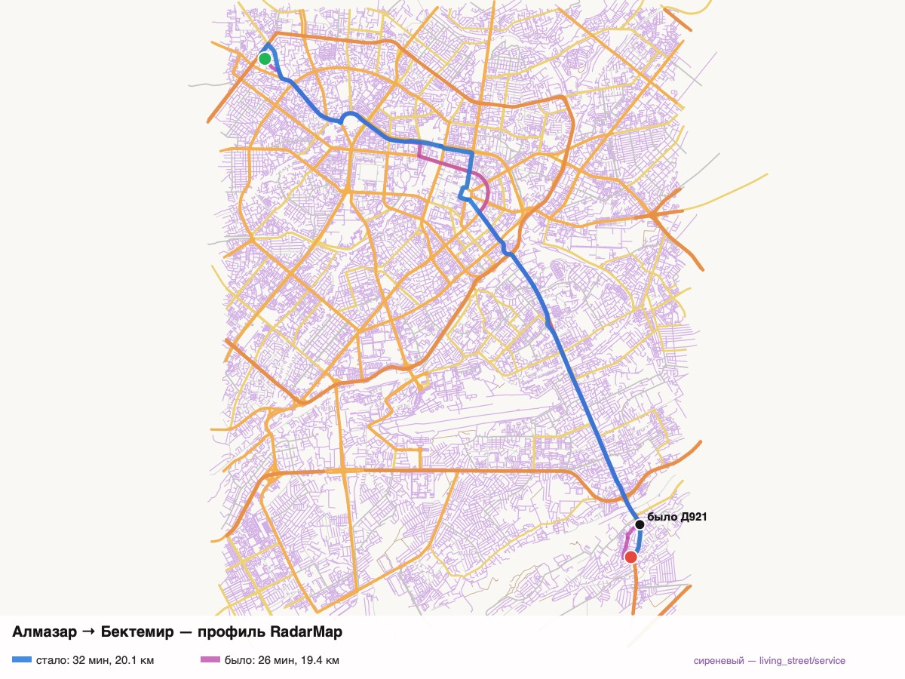
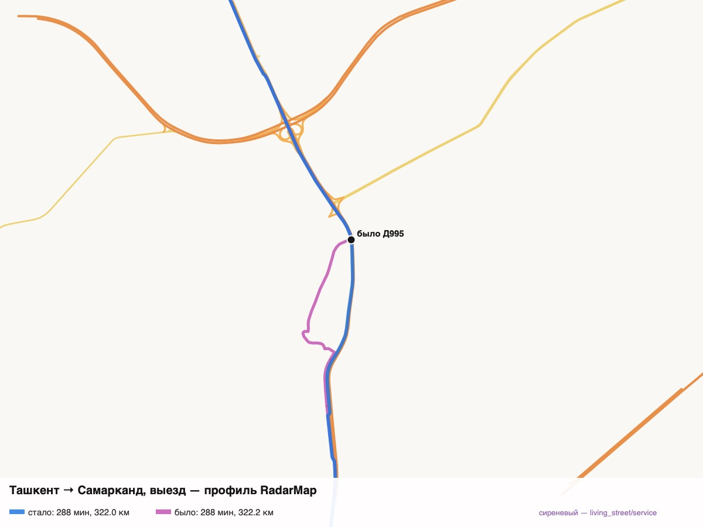
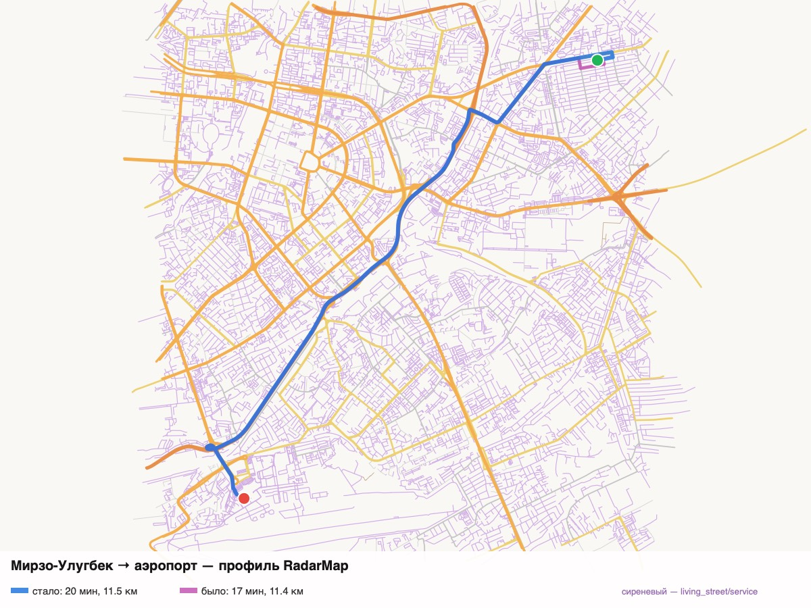
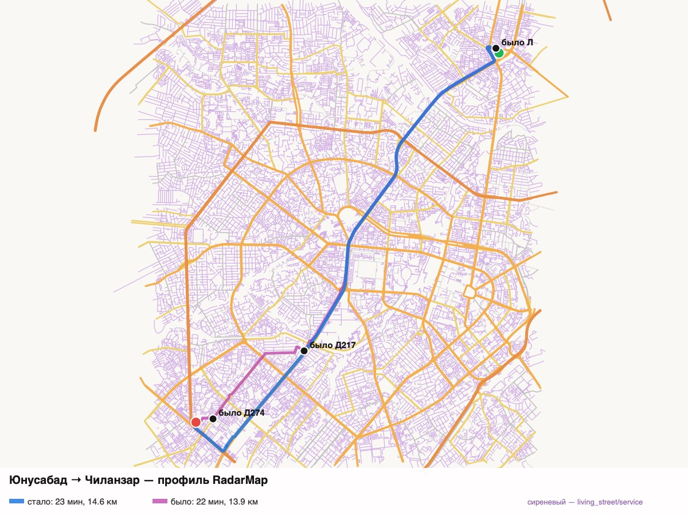
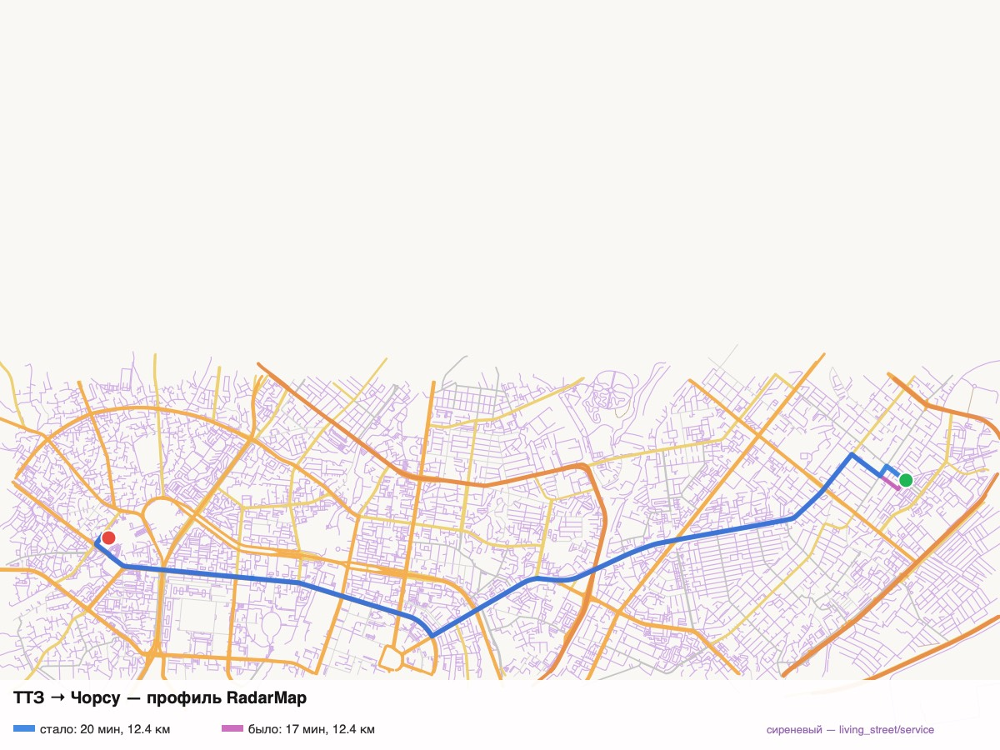
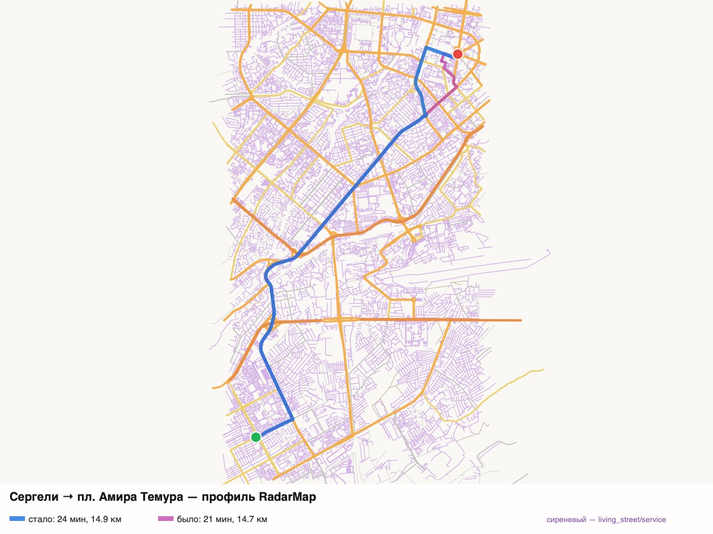
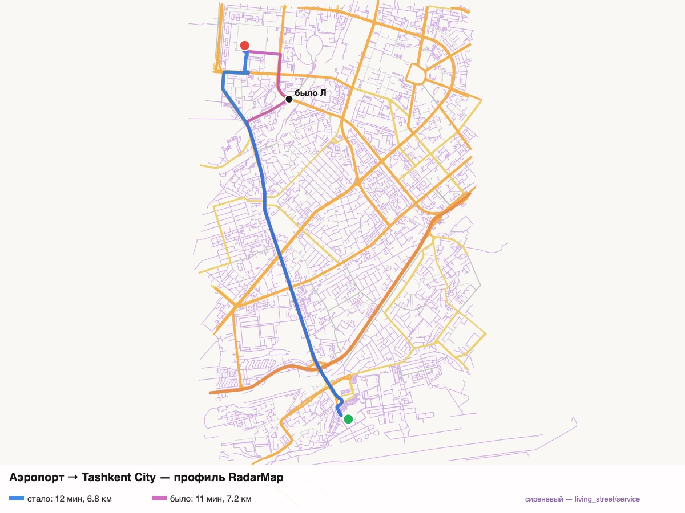

Прод до правки точки аэропорта — 3,8 км махаллями:
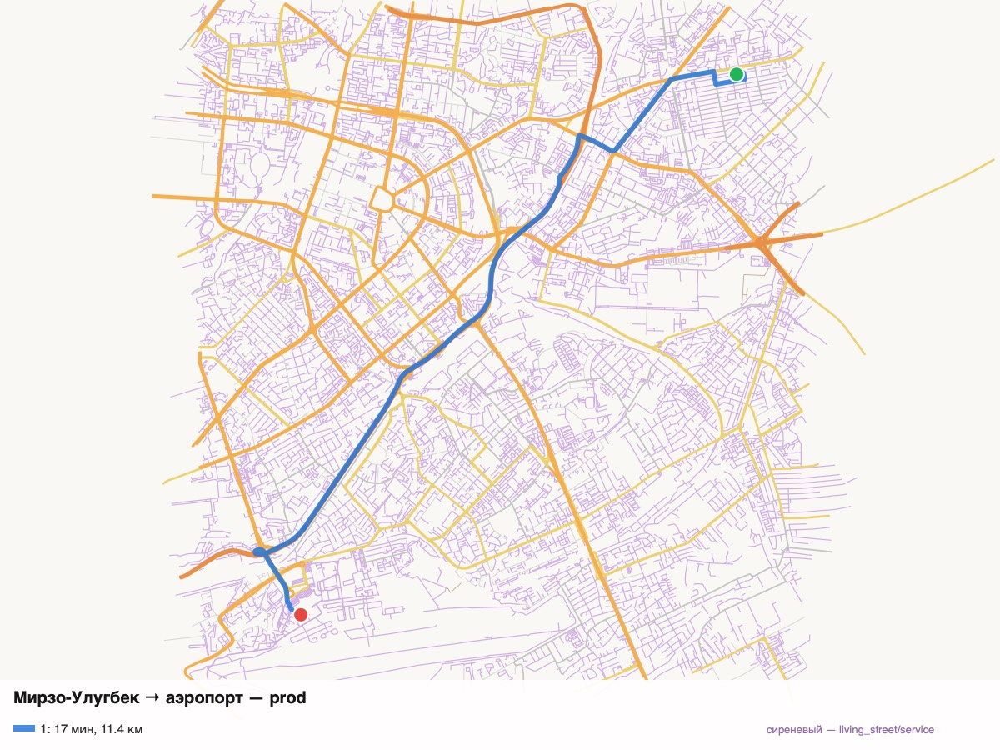

Молчаливый поворот, который теперь звучит (Sharq Tongi), и «ступенька»,
которая остаётся тихой (Seul):
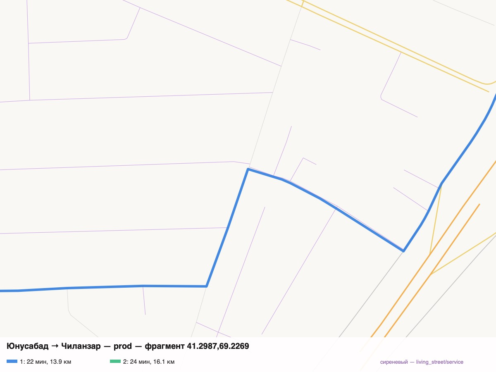
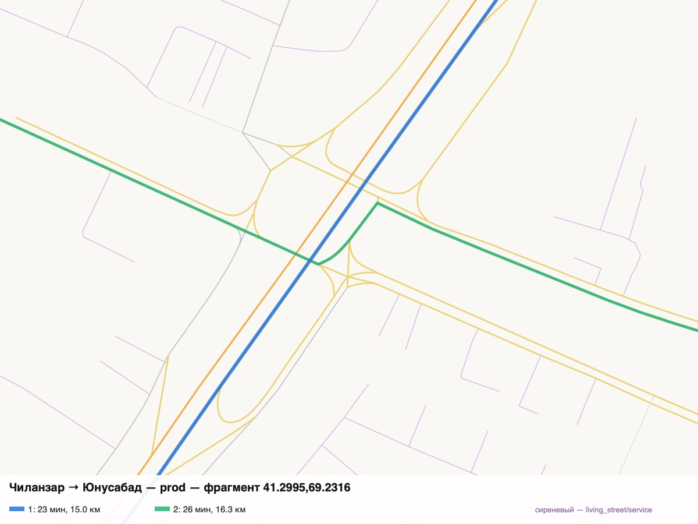

Прибытие на одностороннюю проезжую часть с целью слева — данные точки,
curb здесь не помогает:
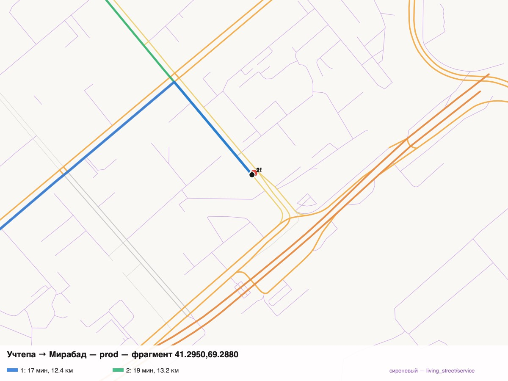

## CH или MLD

| | CH (сейчас) | MLD |
|---|---|---|
| Вариантов на 20 парах (с `alternatives=3`) | 32, у 8 пар один, трёх нет | 36, у 6 пар три |
| Пробки в граф (`osrm-customize`) | нет | да, без пересборки |
| Сборка | только на маке (extract 2,3–3 ГБ) | только на маке |
| Раздача на VPS | ~50 МБ резидентно (mmap) | ~50 МБ резидентно (mmap) |
| Ташкент → Самарканд | 1,1 с (холодный кэш) | 0,34 с |

Новый профиль работает и на CH: дефекты 1, 2 и 4 закрываются без смены
режима. MLD добавляет третий вариант и готовит пробки в граф. Его упирает
не память раздачи, а только сборка — а она и так на маке. Команды выкатки и
отката — `server/osrm/README.md`.

## Что сделано в приложении (работает с текущим сервером)

- `Models/OSRMQuery.swift` — `alternatives=3`, `approaches=…;curb`. Если
  сервер отверг параметры (4xx), один повтор прежним запросом
  (`OSRMQuery.send`), и маршрут строится. Прод CH v26.7.3 принимает оба
  параметра, проверено 25.10, и с `bearings`, и с опорными точками
  «Моей дороги».
- `Models/TurnBend.swift` — голос на изломе `continue`/`new name`.
- `RouteChoice` — «Проще» первым, когда стоит ≤ max(1 мин, 5 %).
- `Variant.ourCameraCount` — счёт камер без доказанно встречных: плашка,
  строка маршрута, CarPlay-превью, Siri, «Меньше камер», «Спокойнее».
- DEBUG `-osrmBase <url>` — приложение на локальном OSRM для снимков «после».

Не тронуто: камеры, оповещения, гейты.
